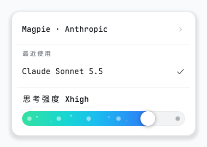
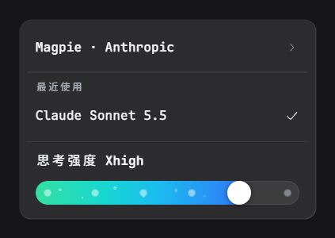
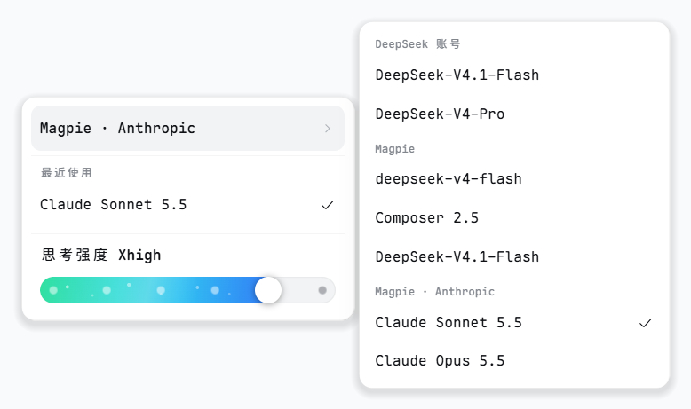
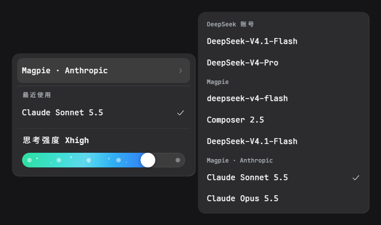

# dsh-effort-menu

A replacement model menu for the [DeepSeek Harness](https://github.com/deepseek-ai/deepseek-harness) composer: pick a model and set its reasoning effort in the same popup.

[](./LICENSE)
[](#compatibility)

English | [简体中文](./README.zh-CN.md)

In the shipped menu, effort lives in a submenu: after switching models, the "Effort" row opens a second list with Default, Low, High and Max. Following zcode's approach, this plugin puts the levels on a slider at the bottom of the menu instead. The slider has one node per level the current model supports, so the effort can be dragged right after picking a model.

The three most recent models sit at the top, and hovering the provider row opens every model in a flyout. Reads and writes go through the shipped per-session model directory, so the native selector and the `/model` popup share the same state.

## Screenshots

The model menu, with the reasoning-effort slider at the bottom.

| Light | Dark |
| --- | --- |
|  |  |

Hovering the provider row opens a flyout with every provider's models.





## Features

- The current level carries over on a model switch; if the new model lacks it, its highest level is used.
- A model without its own default gets a leading "Default" node that leaves the choice to the provider.
- A model list that fails to load is reported in the menu with a retry button.
- Keyboard support. Arrow keys move between items and adjust the slider, `Esc` closes the menu.
- Follows the app's light and dark themes; interface text in English and Chinese.

## Install

Requires a DeepSeek Harness build that ships the `dsh-client-ui-conversation`, `dsh-client-ui-model-selection` and `dsh-client-locale` client packages (see [Compatibility](#compatibility)).

### Web

With a CLI-managed profile, one command installs it into `web`.

```sh
dsh plugin --profile web add github:xuanfenglajiao/dsh-effort-menu
```

There is no build step. The browser half is the committed `client.js`. Restart `dsh web`, or reload the page.

### Desktop

The `desktop` profile is managed by the app, so `dsh plugin` refuses it. Clone the repository, then open **Plugin Manager** and install the checkout directory.

```sh
git clone https://github.com/xuanfenglajiao/dsh-effort-menu.git
```

Restart the app after installing.

### Manual

If you would rather not use the CLI, edit the profile's own `package.json`.

**Web profile.** Edit `~/.dsh/profiles/web/package.json` and add the package to `dependencies`.

```json
"dependencies": {
  "dsh-effort-menu": "github:xuanfenglajiao/dsh-effort-menu"
}
```

Then append it to the `dsh.profile.bundles` array.

```json
"bundles": ["@deepseek-ai/dsh-base", "@deepseek-ai/dsh-web-app", "dsh-effort-menu"]
```

Run `pnpm install` in that directory and restart `dsh web`.

**Desktop profile.** Edit `~/.dsh/profiles/desktop/package.json` and add the same entry to `dependencies` only. The desktop profile does not list plugins in `bundles`.

```json
"dependencies": {
  "dsh-effort-menu": "github:xuanfenglajiao/dsh-effort-menu"
}
```

Run `pnpm install` and restart the app.

**Uninstall** with `dsh plugin --profile web remove dsh-effort-menu`, or remove it in Plugin Manager on the desktop app.

## Compatibility

- Developed and tested on DeepSeek Harness Desktop 44.7.0 (DSH `0.2.2-rc.1`) on Windows 11. Earlier DSH lines are untested.
- The current model must expose `reasoning.efforts` for the slider to have anything to show. Otherwise the menu says the model provides no levels.
- Renders nothing in subagent sessions.

## Known limitations

- **One occupant of the model slot.** The plugin takes over the single slot `conversation.input.model` at priority `-1`, shadowing the shipped selector. Another plugin that replaces the same slot competes for it, so install only one. Plugins that restyle the shipped selector from outside may not apply to this menu.
- **The model label sub-slot is not extensible.** `conversation.input.model.label` is declared by the shipped model-selection package, and a second declaration makes the whole client entry fail to load. This plugin therefore renders model names itself, and labels that other plugins contribute to that sub-slot do not appear here.
- **No automated tests yet.** Changes are checked by hand in a running app.
