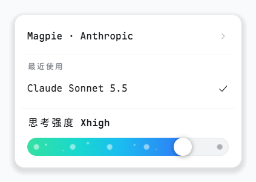
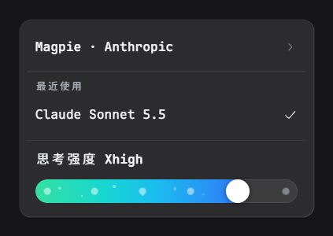
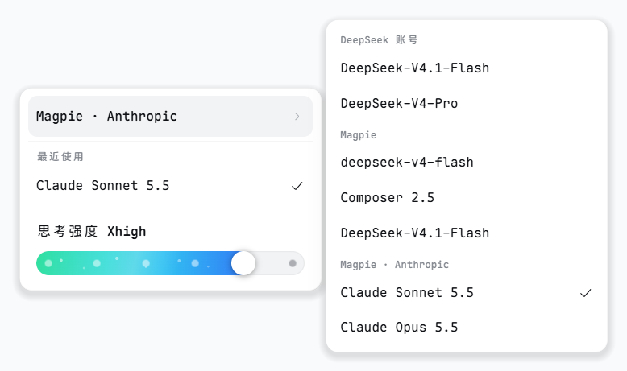
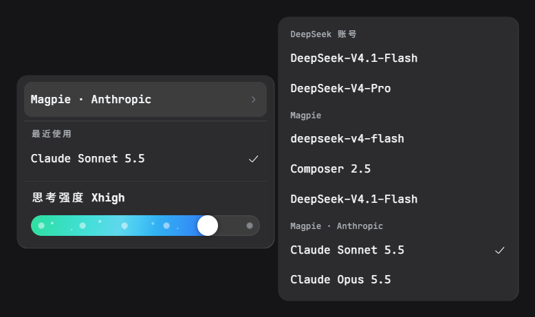

# dsh-effort-menu

给 [DeepSeek Harness](https://github.com/deepseek-ai/deepseek-harness) 输入框换一个模型菜单，选模型和调思考强度在同一个弹层里完成。

[](./LICENSE)
[](#兼容性)

[English](./README.md) | 简体中文

官方菜单把思考强度放在二级菜单「推理等级」里，换完模型还要再点进去，从 Default、Low、High、Max 里挑。本插件参考 zcode 的做法，把档位做成菜单底部的一条滑杆。当前模型有几档，滑杆上就有几个点，选完模型直接拖。

顶部列着最近用过的三个模型，悬停提供商行会在右侧展开全部模型。读写走的是官方的会话模型目录，和原生选择器、`/model` 弹窗共用一份状态。

## 截图

模型菜单，底部是当前模型的思考强度滑杆。

| 浅色 | 深色 |
| --- | --- |
|  |  |

悬停提供商行，会在右侧展开全部提供商的模型。





## 功能

- 切换模型时沿用当前档位，新模型没有这一档就用它的最高档。
- 模型没有自带默认值时，滑杆最左侧多一个「默认」档，交给提供商决定。
- 模型列表加载失败会在菜单里提示，可以直接重试。
- 支持键盘操作。方向键切换菜单项、调节滑杆，`Esc` 关闭菜单。
- 跟随应用的浅色和深色主题，界面提供中文和英文。

## 安装

需要 DSH `0.2.2-rc.1` 或更新版本，并自带 `dsh-client-ui-conversation`、`dsh-client-ui-model-selection` 和 `dsh-client-locale` 三个客户端包（见[兼容性](#兼容性)）。

### Web 端

用 CLI 管理 profile 时，一条命令装进 `web`。

```sh
dsh plugin --profile web add dsh-effort-menu
```

本插件没有构建步骤，浏览器端就是仓库里提交的 `client.js`。装完重启 `dsh web`，或者刷新页面。

### 桌面端

`desktop` profile 由应用管理。先完全退出桌面应用，再用 CLI 安装；或者不退出，打开应用内的 **Plugin Manager** 选择安装这个目录。

```sh
# CLI 安装，需要先完全退出桌面应用
dsh plugin --profile desktop add dsh-effort-menu

# 或者克隆下来，在 Plugin Manager 里选择这个目录
git clone https://github.com/xuanfenglajiao/dsh-effort-menu.git
```

装完重启应用。

### 手动安装

不想动 CLI 时，可以直接改 profile 自己的 `package.json`。

**Web profile。** 编辑 `~/.dsh/profiles/web/package.json`，在 `dependencies` 里加上本插件。

```json
"dependencies": {
  "dsh-effort-menu": "^1.0.0"
}
```

再把它追加到 `dsh.profile.bundles` 数组里。

```json
"bundles": ["@deepseek-ai/dsh-base", "@deepseek-ai/dsh-web-app", "dsh-effort-menu"]
```

然后在同一目录执行 `pnpm install`，重启 `dsh web`。

**桌面端 profile。** 编辑 `~/.dsh/profiles/desktop/package.json`，只在 `dependencies` 里加同样的条目。桌面端不把插件写进 `bundles` 列表。

```json
"dependencies": {
  "dsh-effort-menu": "^1.0.0"
}
```

执行 `pnpm install`，重启应用。

**卸载**时执行 `dsh plugin --profile web remove dsh-effort-menu`，桌面端在 Plugin Manager 里移除即可。

## 兼容性

- 支持 DSH `0.2.2-rc.1` 及更新版本。开发和测试用的是 DeepSeek Harness Desktop 44.7.0（DSH `0.2.2-rc.1`），Windows 11；更早的 DSH 版本不受支持。
- 当前模型必须公布 `reasoning.efforts`，滑杆才有内容可显示。否则菜单会提示该模型没有可选档位。
- 在子代理会话中不渲染任何内容。

## 已知限制

- **模型槽位只能有一个占用者。** 本插件以优先级 `-1` 接管单占位槽 `conversation.input.model`，遮住官方选择器。其他同样替换该槽位的插件会与它竞争，请只安装其中一个。从外部给官方选择器改样式的插件，可能对这个菜单不生效。
- **模型标签子槽无法扩展。** `conversation.input.model.label` 由官方 model-selection 包声明，重复声明会让整个客户端条目加载失败。因此本插件自己渲染模型名称，其他插件贡献到该子槽的标签不会显示在这里。
- **暂无自动化测试。** 目前靠在运行中的应用里手工验证。
